# 软件工程 · 实验三：软件实现与构建

> **项目** MultiBilling 团队账目记录工具
> **学号** 251220124　**姓名** 黄家祺　**日期** 2026-11-14

## 一、实验概述

本实验将实验二的 UML 设计落地为可编译、可运行、可测试的代码，并完成构建与 Git 本地/远程托管。三条实验目的对应三项产出：用 Flutter 构建工具链编译运行桌面应用；以大模型辅助生成代码、单元测试与模拟用户测试；用 Git 建立本地仓库并推送至 GitHub 远程仓库。

### 1.1 技术选型

| 层次 | 选型 | 理由 |
| --- | --- | --- |
| 语言/框架 | Dart 3.14 / Flutter 3.50（stable） | 声明式 UI、强类型枚举、内置测试与 golden 渲染；单一语言覆盖界面与业务。 |
| 目标平台 | macOS 桌面（Release .app） | 任务书建议桌面应用，便于后续实验做分析与测试；沙盒运行。 |
| 组件库 | material_ui 1.11 | Flutter 3.47+ 将 Material 独立为 material_ui 包，替代已弃用的 flutter/material。 |
| 持久化 | 内存数据库 + 原子化 JSON 存档 | 单机桌面版无需服务端；整库序列化落盘，附件按 SHA-256 存本地目录。 |
| 构建/检查 | flutter build / analyze / test、dart format | 官方工具链完成编译、静态检查、单元与界面测试、格式化。 |
| 版本管理 | Git + GitHub（HyperPlusQ/MultiBilling） | 与实验一/二同一项目仓库，按实验目录组织。 |

### 1.2 与实验二设计的对应及实现偏差

实验二的八项设计决策（D1~D8）全部保留并在代码中落地；因改为单机桌面实现，基础设施层做了如下等价替换，业务规则不变。

| 实验二设计 | 实验三实现 | 说明 |
| --- | --- | --- |
| BigDecimal 金额 | Money 定点分（int cents） | 避免浮点误差；0.1+0.2==0.3 有测试保证。 |
| java.time.LocalDate | 自定义 LocalDate 值类 | 仅日期语义，含闰年/区间/加减天数。 |
| BCrypt 口令哈希 | 加盐迭代 SHA-256（20000 轮） | 单机无 BCrypt 依赖；盐随机、格式自描述、可校验。 |
| MySQL/Redis/MinIO | 内存仓储 + JSON 存档 + 本地附件目录 | 仓储接口不变，仅实现替换；乐观锁 version 保留。 |
| Spring Boot REST | 进程内应用服务（AppServices 装配） | 去掉 HTTP 层，服务签名显式传 userId，权限仍在策略层判定。 |
| Vue Web 前端 | Flutter macOS 桌面 | 导航轨 + 顶栏 + 内容区；七页对应实验二界面。 |

## 二、从 UML 到代码的映射

### 2.1 映射方法

按「图回答的问题」逐张翻译：类图给出实体与不变量，服务协作类图给出依赖方向，状态图给出迁移表，时序图给出编排顺序，组件/部署图给出目录与运行形态。先写领域与策略（纯 Dart、可单测），再写仓储接口与内存实现，最后写服务编排与界面，保证下层不依赖上层。

| UML 图 | 代码落点 | 翻译要点 |
| --- | --- | --- |
| 类图（领域模型） | lib/domain/*.dart（15 文件） | 12 实体→类；8 枚举→enum；Ledger 聚合根；Entry.version 乐观锁；OperationLog.prevHash 自引用。 |
| 类图（服务协作） | lib/service/*、lib/policy/*、lib/repository/repositories.dart | 应用服务→Service 类；5 策略→Policy 类；仓储→抽象接口 + Memory 实现。 |
| 组件图 | lib/ 分层目录 + app_services.dart | 组件边界=目录边界；装配根一次性接线，界面只持 AppServices。 |
| 部署图 | lib/main.dart + macos/ Runner | 单机节点→macOS 沙盒进程；数据目录 per-user；JSON 存档 + 附件目录。 |
| 用例图 | lib/ui/screens/* + 各 Service 用例方法 | 22 用例→服务方法 + 七页界面；参与者权限→PermissionPolicy。 |
| 活动图 | EntryService.submit / ReviewService.review | 三判断点（字段/重复/金额）→校验链；分支→Workflow 迁移。 |
| 状态图 | lib/policy/entry_workflow.dart | DRAFT→PENDING→APPROVED/REJECTED→INVALID 迁移表集中执行，非法抛异常。 |
| 时序图：提交与审核 | EntryService/ReviewService + AuditLogService | 编排顺序=方法调用顺序；存档旁路=DomainEvent 订阅。 |
| 时序图：作废与投票 | VoidRequestService + VoidApprovalPolicy | 快照管理员数→创建→投票→计票；72h 超时用可注入 clock。 |

### 2.2 分层与目录

| 层次 | 目录 | 文件数 | 职责 |
| --- | --- | --- | --- |
| 领域层 | lib/domain | 15 | 实体、枚举、值类（Money/LocalDate）、口令哈希、领域异常。 |
| 策略层 | lib/policy | 5 | 状态机、权限、重复检测、金额限制、作废投票。 |
| 仓储层 | lib/repository | 4 | 仓储接口、内存数据库、内存实现、JSON 持久化。 |
| 服务层 | lib/service | 9 | 用例编排、事务边界、领域事件→存档。 |
| 装配根 | lib/app_services.dart、main.dart | 2 | 依赖接线、数据目录、载入/播种。 |
| 界面层 | lib/ui | 17 | Session 会话、主题、通用组件、七页 + 详情/编辑/投票组件。 |

### 2.3 关键设计决策的代码落地

| # | 决策 | 代码落点与验证 |
| --- | --- | --- |
| D1 | 身份与权限正交 | enums.dart 的 MemberIdentity×MemberRole；PermissionPolicy.isValidCombination 校验；permission_policy_test 覆盖。 |
| D2 | 四板块=状态投影 | EntryStatus 单枚举；EntriesScreen 按状态过滤计数；不建四张表。 |
| D3 | 状态迁移集中 | EntryWorkflow 迁移表；entry_workflow_test 穷举合法/非法迁移。 |
| D4 | 乐观锁 | Entry.version 递增；仓储 update 校验版本冲突抛异常。 |
| D5 | 作废票数快照 | VoidRequest.adminCountSnapshot；agree*2>snapshot 严格多数；void_approval_policy_test 覆盖 0~6 快照。 |
| D6 | 修改=旧 INVALID+新 PENDING | ReviewService 审批修改申请时置旧条目 INVALID、建新条目 PENDING；集成测试验证。 |
| D7 | 存档旁路 | DomainEvent→AuditLogService 追加写；哈希链 SHA-256(prevHash+规范化JSON)；operation_log_test 验证篡改检测。 |
| D8 | 统计单一口径 | 仓储层固定 status=APPROVED；StatisticsService.caliberNote 界面标注；集成测试验证口径。 |

### 2.4 结构图对照

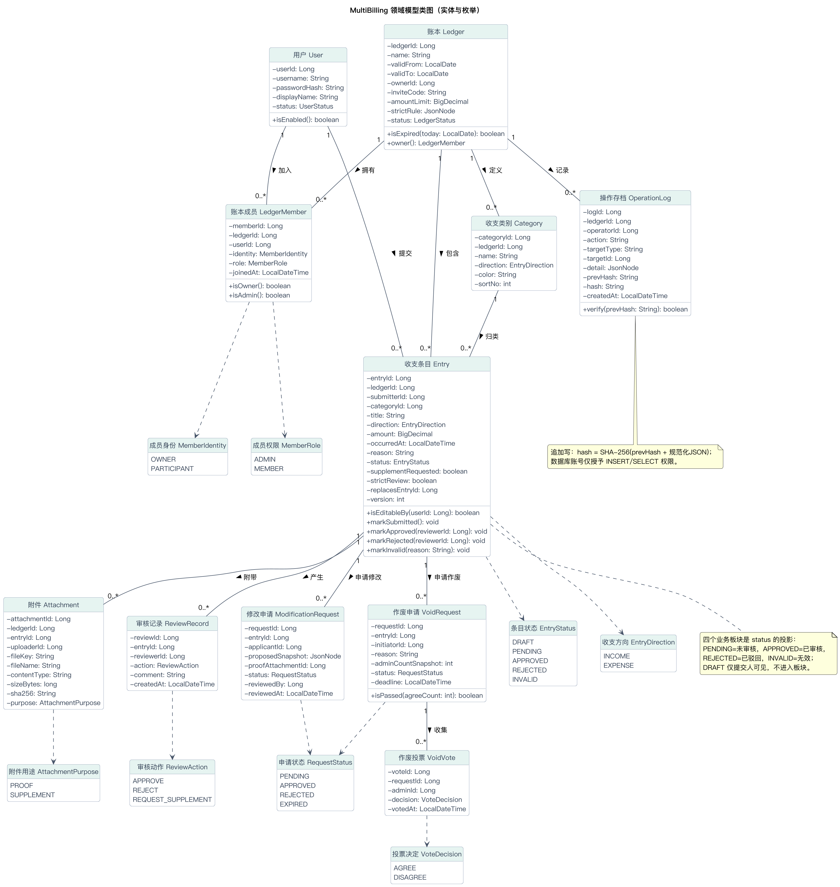
*图 2-1 领域类图 → lib/domain（实体/枚举/不变量）*

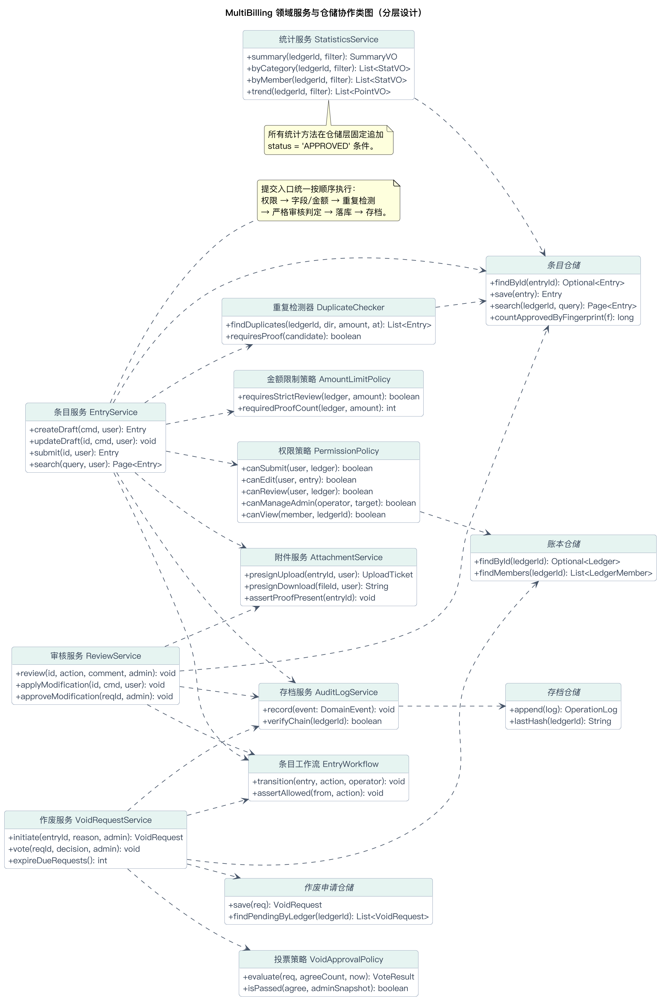
*图 2-2 服务协作类图 → lib/service + lib/policy + 仓储接口*

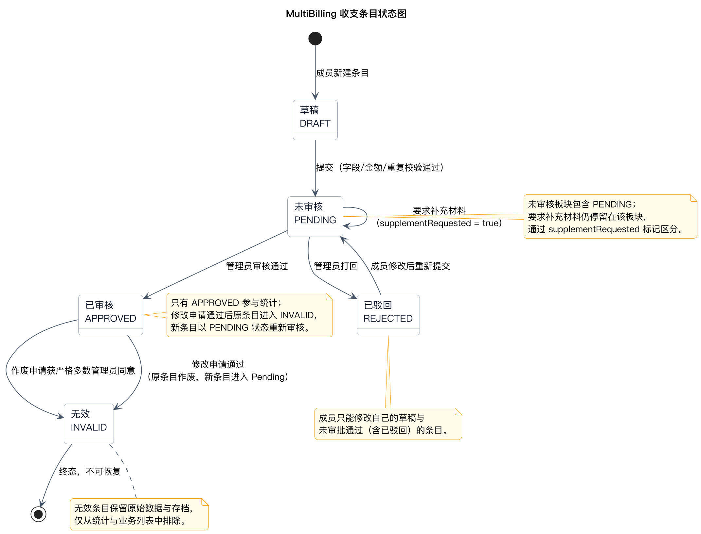
*图 2-3 状态图 → EntryWorkflow 迁移表*

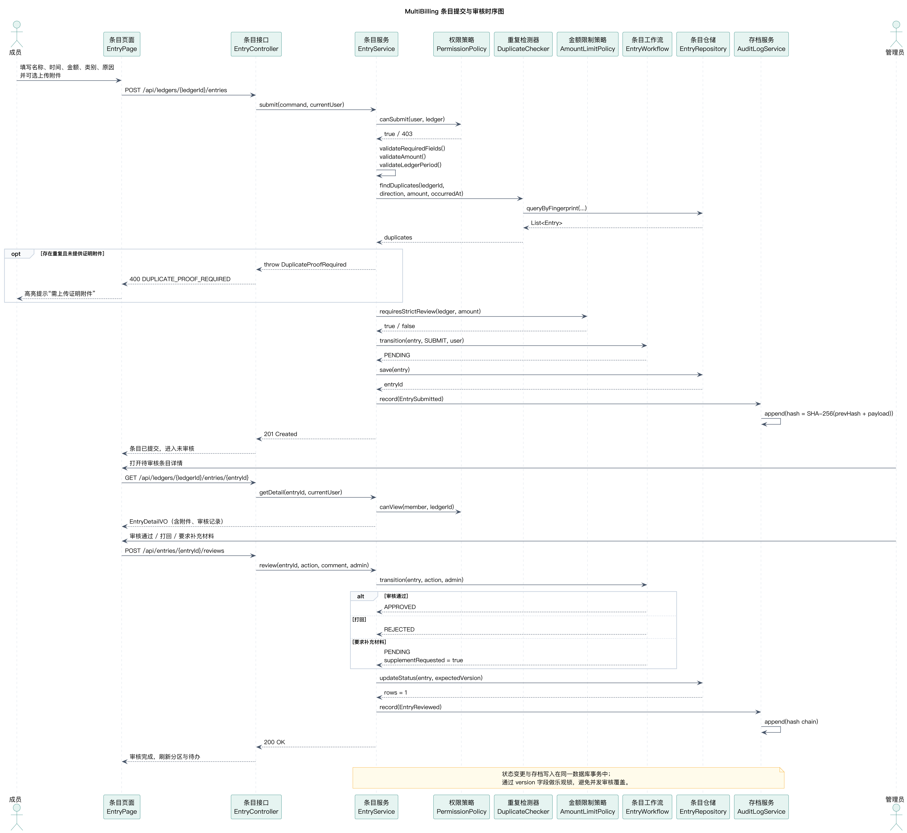
*图 2-4 提交/审核时序 → EntryService/ReviewService 编排 + 存档旁路*

## 三、源代码规模

统计口径：非空行（去除纯空白行）。Flutter 无 GUI 设计器，全部界面代码亦为手写；macos/ Runner 为平台脚手架、build/ 与 .dart_tool/ 为生成物，均不计入。

| 部分 | 文件数 | 非空行 | 性质 |
| --- | --- | --- | --- |
| lib/domain | 15 | 1536 | 手写 |
| lib/policy | 5 | 342 | 手写 |
| lib/repository | 4 | 837 | 手写 |
| lib/service | 9 | 1787 | 手写 |
| lib/app_services.dart + main.dart | 2 | 393 | 手写 |
| lib/ui（界面） | 17 | 4614 | 手写（非 GUI 工具生成） |
| **lib 合计** | **52** | **9509** | 原始行 10501 |
| test（单元+界面测试） | 10 | 1598 | 手写，原始行 1768 |
| **手写总计（lib+test）** | **62** | **11107** | 远超 1500 行要求 |

> 仅计非界面核心（domain+policy+repository+service+装配）即 4895 非空行，已远超「大于 1500 行（GUI 自动生成除外）」的要求；界面 4614 行为手写 Flutter 组件，亦非设计工具产物。

## 四、代码风格与静态检查

- **格式化**：`dart format lib test` 全量通过，统一缩进与尾逗号。
- **静态检查**：`flutter analyze` 结果 `No issues found!`（lib 与 test 全量）。
- **严格模式**：analysis_options.yaml 开启 strict-casts / strict-inference / strict-raw-types，杜绝隐式动态类型。
- **Lint 规则**：flutter_lints 6 + require_trailing_commas、prefer_single_quotes、unnecessary_* 等；测试中分隔符回调统一 `(_, _)` 避免未用参数告警。
- **弃用迁移**：Flutter 3.50 弃用 `flutter/material.dart`，16 个界面文件统一迁移到 `material_ui/material_ui.dart`，消除全部 deprecation 告警。

## 五、大模型辅助实现记录

### 5.1 让大模型做的工作

| 场景 | 生成内容 | 我的审查与落地 |
| --- | --- | --- |
| 功能性代码生成 | 按 UML 与 REQ 生成 domain/policy/repository/service 初稿 | 逐文件阅读核对不变量与迁移表；调整装配根接线；确认下层不依赖上层。 |
| 单元测试设计 | 10 个测试文件、129 用例（值类/状态机/权限/投票/哈希链/认证/集成/界面冒烟） | 核对断言是否真验证规则而非复述实现；补充边界（快照 4 需 3 票、金额等于上限不超限）。 |
| LLM 模拟用户测试 | widget 冒烟测试驱动真实应用逐屏渲染；golden 渲染产出界面截图 | 以渲染异常/截图为客观验收，替代人工点屏；发现并修复两处真实缺陷（见 5.2）。 |
| 代码风格检查 | format/analyze 告警清单与修复建议 | 采纳迁移与 lint 修复；拒绝无意义改动；最终 analyze 零告警。 |

### 5.2 生成内容不符合预期时的处理

| 不符合预期之处 | 发现方式 | 处理 |
| --- | --- | --- |
| 重复证明门槛成死代码：requiresProof 对草稿候选短路返回 false，而 submit/preview 在条目仍为草稿时调用它，REQ-012 永不触发 | 集成测试断言 requiresProof==true 失败 | 删除草稿短路（createDraft/updateDraft 本就不经过该方法）；findDuplicates 已排除自身与无效条目；测试转绿。 |
| EntriesScreen 在 initState 调 Session.of(context)（依赖 inherited），违反 Flutter 生命周期 | 界面冒烟测试抛 FlutterError | 移至 didChangeDependencies 并加一次性 _focusConsumed 守卫，避免会话刷新重置板块。 |
| 测试助手硬编码统计口径文案（假断言） | 自查发现断言未引用真实实现 | 改为 import StatisticsService 并断言真实 caliberNote，杜绝「自证式」测试。 |
| 集成测试缺 EntryCommand import 导致编译崩溃 | flutter test 加载失败 | 补 import；连带消除共享编译器崩溃的级联报错。 |
| 沿用已弃用 flutter/material 产生 16 处 deprecation | flutter analyze | 引入 material_ui 并统一替换 import。 |

**总结。** 大模型擅长结构化初稿、批量一致代码与边界清单；不擅长语义精确与「看见结果」的验收。有效用法是嵌入可验证循环：生成→编译/测试/渲染客观验证→反馈修正。本次两处真实缺陷均由测试而非人工阅读发现，印证该循环的必要性。

## 六、编译与运行结果

### 6.1 环境

```text
Flutter 3.50.0 • channel stable • Framework revision ab2912035e (2026-11-09)
Dart 3.14.0 • macOS desktop (arm64) • material_ui 1.11.0
```

### 6.2 静态检查

```text
$ flutter analyze
Analyzing multibilling...
No issues found! (ran in 3.0s)
```

### 6.3 单元与界面测试

```text
$ flutter test
00:04 +129: All tests passed!
```

| 测试文件 | 用例 | 覆盖 |
| --- | --- | --- |
| money_test | 12 | 定点金额、解析、格式化、比较 |
| local_date_test | 13 | 闰年、校验、加减/区间 |
| entry_workflow_test | 15 | 迁移表穷举、提交/审核/重提/作废 |
| permission_policy_test | 15 | 身份×权限、管理员计数、转让/退出 |
| void_approval_policy_test | 18 | 严格多数快照 0~6、超时优先、一人一票 |
| operation_log_test | 9 | 规范化 JSON、哈希链、篡改检测 |
| password_hasher_test | 6 | 哈希/校验、盐唯一、格式 |
| auth_service_test | 12 | 注册校验、登录反枚举、禁用、改密 |
| services_integration_test | 25 | 生命周期、重复门槛、金额边界、修改 D6、作废 D5、存档 D7、统计 D8、转让 A8 |
| ui_smoke_test | 4 | 登录页渲染、界面登录、七页逐屏无异常、登出 |
| **合计** | **129** | 全部通过 |

### 6.4 构建

```text
$ flutter build macos --release
✓ Built build/macos/Build/Products/Release/multibilling.app (44.7MB)
```

### 6.5 运行

直接运行 Release 二进制，控制台无运行时错误，仅渲染后端提示；首启自动播种演示数据（3 账号/1 账本/6 条目覆盖四状态），落盘于沙盒数据目录。

```text
[IMPORTANT:...embedder_surface_metal_impeller.mm(53)] Using the Impeller rendering backend (MetalSDF).
数据目录: ~/Library/Containers/cn.edu.nju.multibilling/Data/Library/Application Support/MultiBilling/multibilling.json
```

### 6.6 界面渲染验证

系统截屏权限不可用，改用 Flutter 测试引擎真实渲染：冒烟测试逐屏断言无构建/布局异常；golden 渲染产出下列界面图（加载系统 CJK 与 Material 图标字体后渲染）。

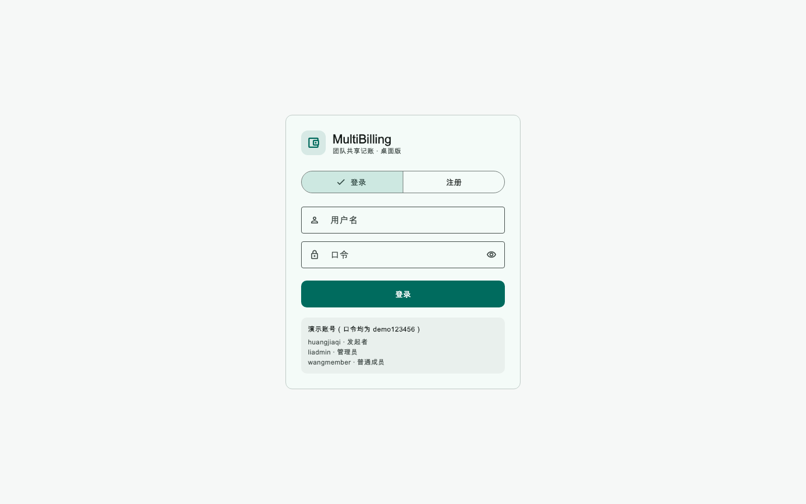
*界面 1 登录/注册*

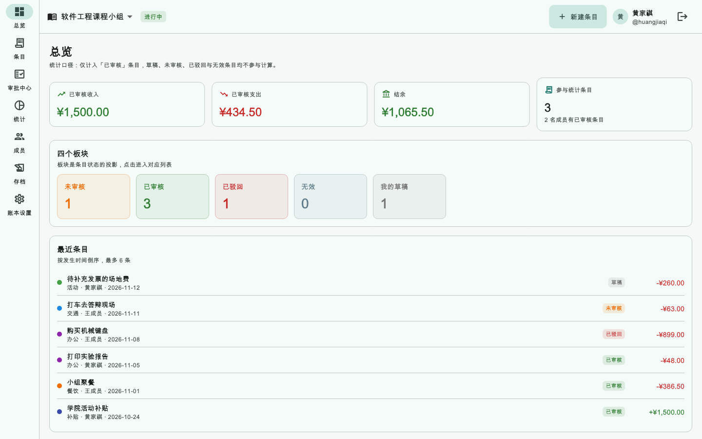
*界面 2 总览：指标卡 + 四板块 + 最近条目*

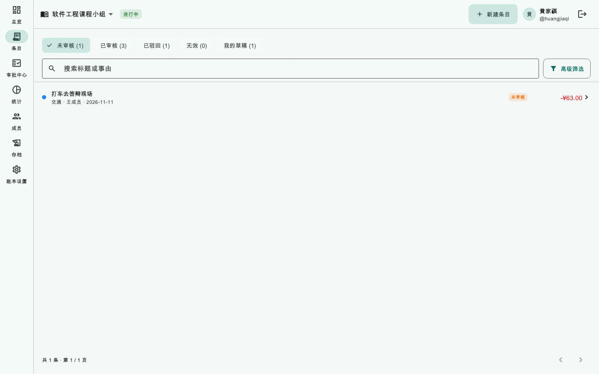
*界面 3 条目：四板块 Tab + 搜索/高级筛选 + 分页*

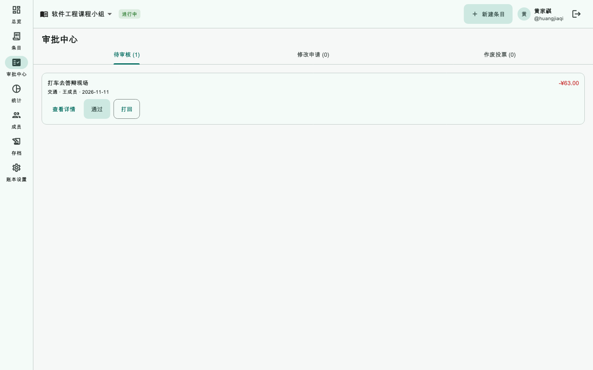
*界面 4 审批中心：待审/修改申请/作废投票*

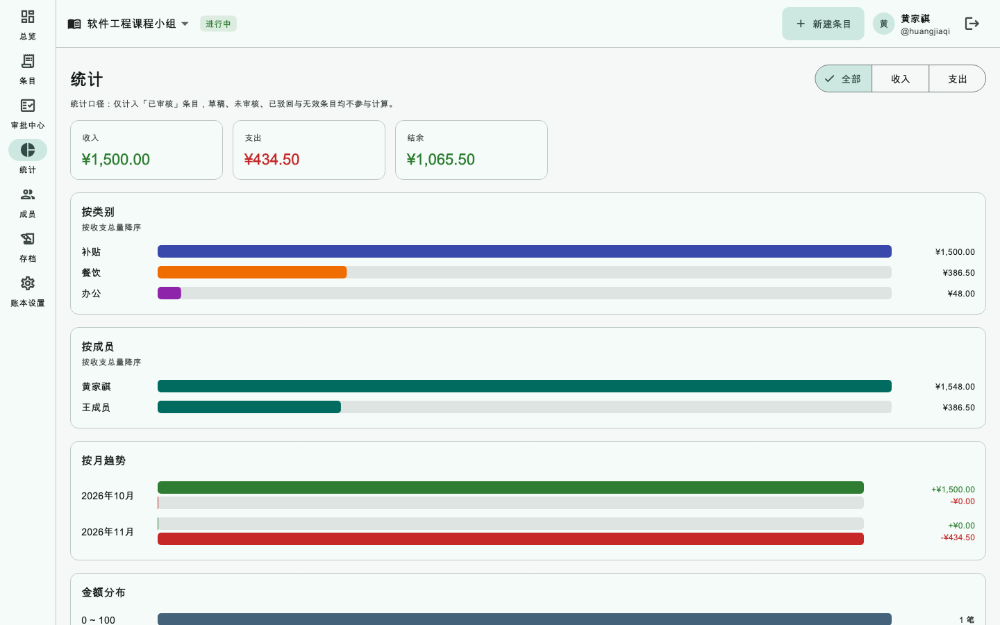
*界面 5 统计：口径标注 + 多维聚合*


*界面 6 成员：身份/权限 + 金额限制*

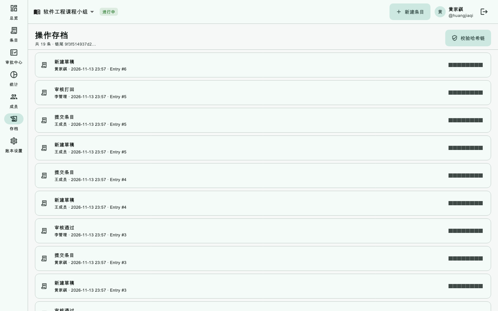
*界面 7 存档：只读 + 哈希链校验*

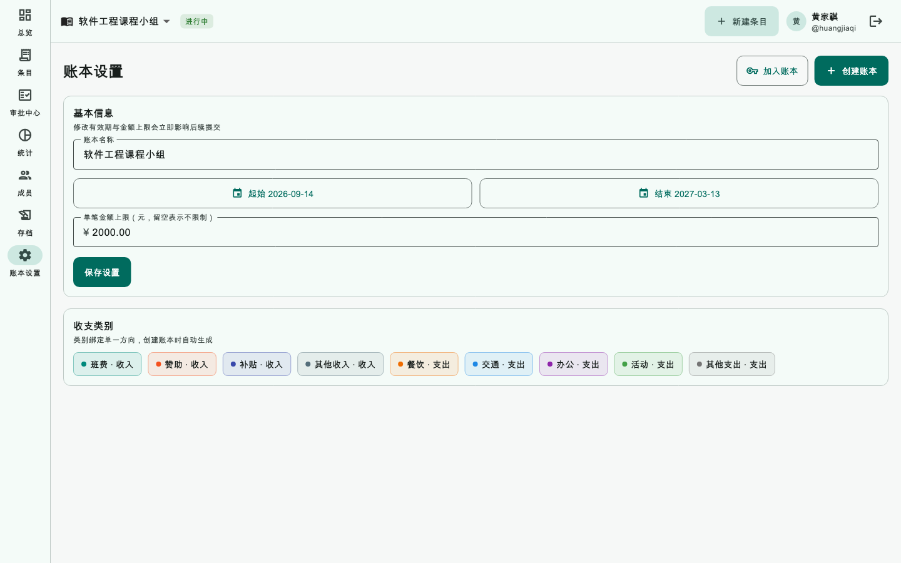
*界面 8 账本设置：有效期/邀请码/类别*

## 七、Git 本地与远程管理

### 7.1 仓库与远程

| 项 | 值 |
| --- | --- |
| 远程仓库 | https://github.com/HyperPlusQ/MultiBilling |
| 默认分支 | main |
| 本地仓库 | 软件工程/MultiBilling（clone 自远程，含实验一/二历史） |
| 实验三目录 | Lab03_251220124_黄家祺/（code/ + UML/ + 报告） |
| 忽略规则 | .gitignore 排除 build/、.dart_tool/、.idea/ 等生成物 |

### 7.2 提交历史

```text
$ git log --oneline
0f33f75 lab3: 软件实现与构建（251220124 黄家祺）Flutter 桌面实现 + 129 测试 + UML + 报告
d715f19 lab2: 软件设计与建模实验报告（251220124 黄家祺）
daef3ae lab1-final: 人工审查后的最终需求与完整访谈、AI 交互及审查记录（REQ-001~REQ-017，REV-001~REV-004）
32bfeef lab1-ai-draft: 访谈记录与 AI 首次生成的需求初稿（REQ-001~REQ-015）

$ git push origin main
   d715f19..0f33f75  main -> main
```

### 7.3 远程目录结构

```text
MultiBilling (main)
├── .gitignore
├── chat.txt / requirements.md          # 实验一
├── Lab02_251220124_黄家祺/              # 实验二（UML/UI界面/报告）
└── Lab03_251220124_黄家祺/              # 实验三
    ├── code/                           # Flutter 工程源码
    │   ├── lib/  test/  macos/
    │   ├── pubspec.yaml  pubspec.lock
    │   └── analysis_options.yaml  README.md
    ├── UML/                            # 9 组 png + puml
    ├── 界面截图/                        # 8 张真实渲染界面图
    ├── report.html
    └── 实验报告.pdf
```

## 八、需求覆盖与测试矩阵

| 编号 | 需求 | 实现落点 | 验证测试 | 状态 |
| --- | --- | --- | --- | --- |
| REQ-001 | 账本创建/有效期 | LedgerService.create + Ledger.validFrom/To + inviteCode | integration | 已覆盖 |
| REQ-002 | 身份与权限 | MemberIdentity×MemberRole + PermissionPolicy | permission_policy | 已覆盖 |
| REQ-003 | 条目提交校验 | EntryService.submit 字段/金额/有效期校验 | integration | 已覆盖 |
| REQ-004 | 审核与四分区 | EntryWorkflow + ReviewService + 状态投影 | entry_workflow / integration | 已覆盖 |
| REQ-005 | 统计仅已审核 | 仓储固定 APPROVED + caliberNote | integration(D8) | 已覆盖 |
| REQ-006 | 五维筛选 | EntryQuery + EntriesScreen 组合过滤 | ui_smoke | 已覆盖 |
| REQ-007 | 分类统计 | StatisticsService 四组聚合 | integration | 已覆盖 |
| REQ-008 | 修改草稿/驳回 | updateDraft 限 DRAFT/REJECTED + 乐观锁 | integration | 已覆盖 |
| REQ-009 | 已审核修改申请 | ModificationRequest 快照+证明；旧 INVALID 新 PENDING | integration(D6) | 已覆盖 |
| REQ-010 | 作废投票 | VoidRequest 快照+严格多数+72h+一人一票 | void_approval / integration | 已覆盖 |
| REQ-011 | 操作存档 | AuditLogService 追加写+哈希链 | operation_log / integration | 已覆盖 |
| REQ-012 | 重复证明 | DuplicateChecker 指纹 + PROOF 门槛 | integration(REQ-012) | 已覆盖 |
| REQ-013 | 金额限制 | Ledger.amountLimit + AmountLimitPolicy（等于不超限） | integration(A6) | 已覆盖 |
| REQ-014 | 防误操作 | 不可逆操作二次确认对话框 | ui_smoke | 已覆盖 |
| REQ-015 | 桌面适配 | 导航轨+顶栏+内容区；1440×900 渲染验证 | ui_smoke / golden | 已覆盖 |
| REQ-016 | 邀请与退出 | joinByInviteCode + leftAt；退出不可读 | integration / permission | 已覆盖 |
| REQ-017 | 数据安全 | 加盐迭代哈希 + 会话 + 成员校验 + 附件 SHA-256 | password_hasher / auth | 已覆盖 |

## 九、总结与不足

本次实验把实验二设计完整落地：52 个 lib 文件、9509 非空行（含测试 11107 行），129 个测试全绿，analyze 零告警，Release .app 构建并运行正常，七页界面经真实渲染验证，代码托管至 GitHub。八项设计决策与 17 条需求均有代码落点与测试对应。

- **设计到代码的关键**是把「规则」收敛到策略类：状态/权限/金额/重复/投票/统计口径各只一处，测试逐条锁定，界面只做投影与提示。
- **测试是验收而非装饰**：两处真实缺陷（重复门槛死代码、initState 生命周期）都由测试暴露；假断言助手被自查替换为引用真实实现。
- **大模型的正确位置**是生成初稿与清单，人负责语义判断与客观验收，形成生成→验证→修正闭环。

不足：单机内存+JSON 持久化未做并发压测；界面验证基于测试引擎渲染而非真机截屏；作废投票超时依赖注入时钟，未做真实长时间运行观察；部分基础设施为等价替换，与服务端部署形态仍有差距。